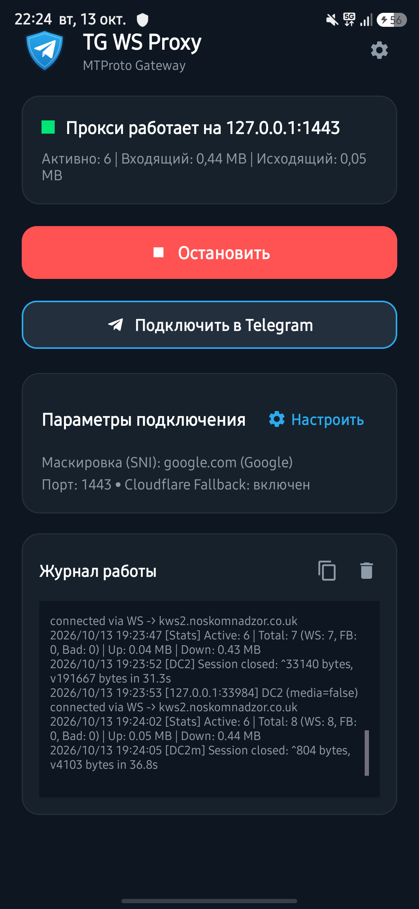
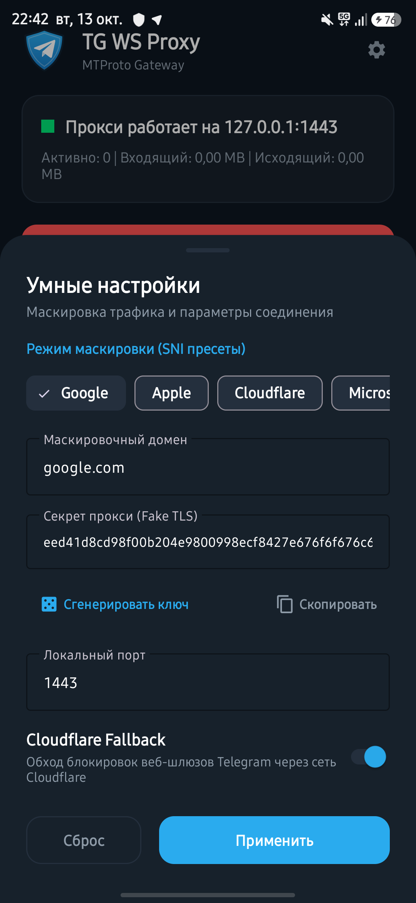

# TG WS Proxy for Android

[](https://github.com/keelbismark/tg-ws-proxy-android/releases/latest)
[-brightgreen.svg)](https://android.com)
[](https://kotlinlang.org)
[](https://golang.org)
[](#)
[](LICENSE)

Нативный Android-клиент и фоновый сервис для обхода замедления и блокировок Telegram (медиафайлы, голосовые, видеосообщения, каналы) без использования стороннего VPN.

Основан на логике проекта [Flowseal/tg-ws-proxy](https://github.com/Flowseal/tg-ws-proxy). Сетевое ядро переписано на **Go** и скомпилировано в разделяемую библиотеку (`libtgproxy.so`), поверх которой работает Android-клиент на **Kotlin & Material 3**.

---

## 📥 Быстрый старт

Готовый файл APK доступен на странице [Releases](https://github.com/keelbismark/tg-ws-proxy-android/releases/latest).

1. Скачайте актуальный **`tg-ws-proxy-v*.apk`** и установите на телефон (поддерживается Android 7.0+).
2. Запустите приложение и нажмите **«Запустить прокси»**.
3. Нажмите **«Подключить в Telegram»** — откроется Telegram с предложением активировать прокси `127.0.0.1:1443`.
4. *(Опционально)* Вынесите переключатель в шторку быстрых настроек Android (Quick Settings Tile) для включения в один тап.

---

## Скриншоты

<p align="center">
  
  &nbsp;&nbsp;&nbsp;&nbsp;&nbsp;&nbsp;
  
</p>

---

## Принцип работы

```
Telegram Client (на устройстве)
      │
      ▼ (MTProto TCP handshake с Fake TLS)
Локальный прокси: 127.0.0.1:1443 (Go Core в Foreground Service)
      │
      ├─► Валидация Fake TLS HMAC (маскировка под google.com, apple.com и др.)
      ├─► Извлечение DC ID (DC1..DC5) и типа сессии (media / non-media)
      ├─► Инкапсуляция пакетов в WebSocket over TLS (WSS)
      │
      ▼ (WSS по порту 443)
Telegram Web Gateways (kws*.noskomnadzor.co.uk / web.telegram.org)
      │ (при блокировке прямого WS — автоматический Fallback через Cloudflare)
      ▼
Telegram Data Centers (DC 1..5)
```

Маскировка выполняется локально: для интернет-провайдера и ТСПУ трафик выглядит как стандартное HTTPS/TLS-обращение к доверенному домену (Google, Apple iCloud и др.).

---

## Возможности

* **Быстрое подключение:** Запуск сервиса и автоматический импорт настроек в Telegram в два нажатия.
* **Нативный интерфейс:** Тёмная тема в палитре Telegram Android, встроенный мониторинг сессий и скорости в реальном времени.
* **Диагностика шлюзов и дата-центров (DC Ping):** Встроенный тест доступности и измерение задержки (RTT) до основных дата-центров Telegram (DC2 Европа/РФ, DC4 медиа, DC1 США, DC5 Азия) и шлюза Cloudflare с наглядной цветовой индикацией.
* **Динамический пул зеркал Cloudflare:** Автоматическое фоновое (раз в 24 часа) и ручное обновление актуальных резервных зеркал из репозитория Flowseal с декодированием на лету.
* **Автозапуск при перезагрузке:** Возможность автоматического запуска прокси-сервиса при включении устройства (`BOOT_COMPLETED`).
* **Умные настройки:**
  * Пресеты SNI-маскировки: Google, Apple, Cloudflare, Microsoft, Яндекс.
  * Автоматическая генерация валидных Fake TLS ключей (`ee<32 hex><domain in hex>`).
  * Настройка локального порта и переключение Cloudflare Fallback.
* **Безопасность и надёжность:**
  * Валидация цепочки TLS-сертификатов при обращении к внешним шлюзам (защита от MITM).
  * Строгий контроль размеров WebSocket-кадров для защиты от переполнения памяти (OOM).
  * Корректный graceful close сессий с ограниченным таймаутом.
* **Низкое потребление ресурсов:**
  * Оперативная память: ~10–14 МБ RAM.
  * Минимальная нагрузка на батарею благодаря горутинам Go.
* **Фоновый режим:**
  * Foreground Service с типами `specialUse`, `WakeLock` и `WifiLock`.
  * Плитка в шторке быстрых настроек Android (Quick Settings Tile).
  * Встроенные Keep-Alive пинги (30 сек) для предотвращения разрыва сессий.
  * Локальный DNS-кэш и параллельный опрос независимых DNS-серверов.
  * Автоматическое восстановление состояния и сохранённых настроек при рестарте сервиса ОС.

---

## Сборка

### Android APK

Требуется Android SDK и JDK 21+:

```bash
cd android
./gradlew assembleRelease
```

Собранный файл:
`android/app/build/outputs/apk/release/tg-ws-proxy-v1.1.0.apk`

### Нативное ядро (Go)

Кросс-компиляция библиотеки под Android выполняется через Android NDK Toolchain:

```bash
cd core

# arm64-v8a
$env:CGO_ENABLED="1"; $env:GOOS="android"; $env:GOARCH="arm64"; $env:CC="<NDK_PATH>/aarch64-linux-android35-clang"
go build -buildmode=c-shared -ldflags="-s -w" -o ../android/app/src/main/jniLibs/arm64-v8a/libtgproxy.so ./cmd/proxy

# armeabi-v7a
$env:CGO_ENABLED="1"; $env:GOOS="android"; $env:GOARCH="arm"; $env:GOARM="7"; $env:CC="<NDK_PATH>/armv7a-linux-androideabi35-clang"
go build -buildmode=c-shared -ldflags="-s -w" -o ../android/app/src/main/jniLibs/armeabi-v7a/libtgproxy.so ./cmd/proxy
```

---

## Лицензия

Проект распространяется под лицензией MIT. Подробнее см. в файле [LICENSE](LICENSE).  
Оригинальная идея и протокол: [Flowseal/tg-ws-proxy](https://github.com/Flowseal/tg-ws-proxy).
